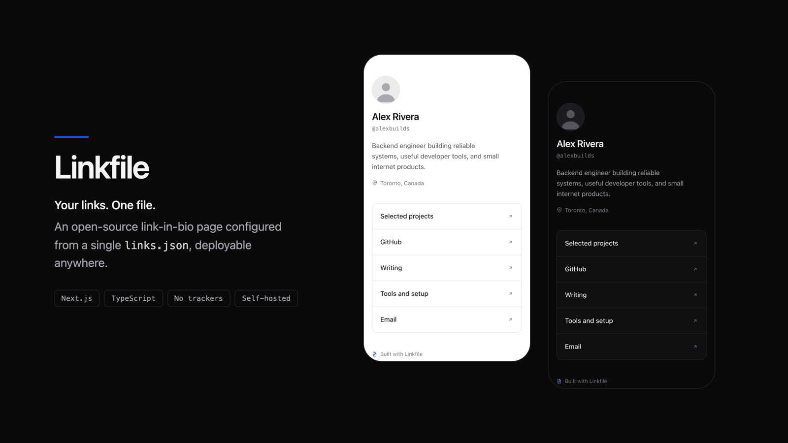
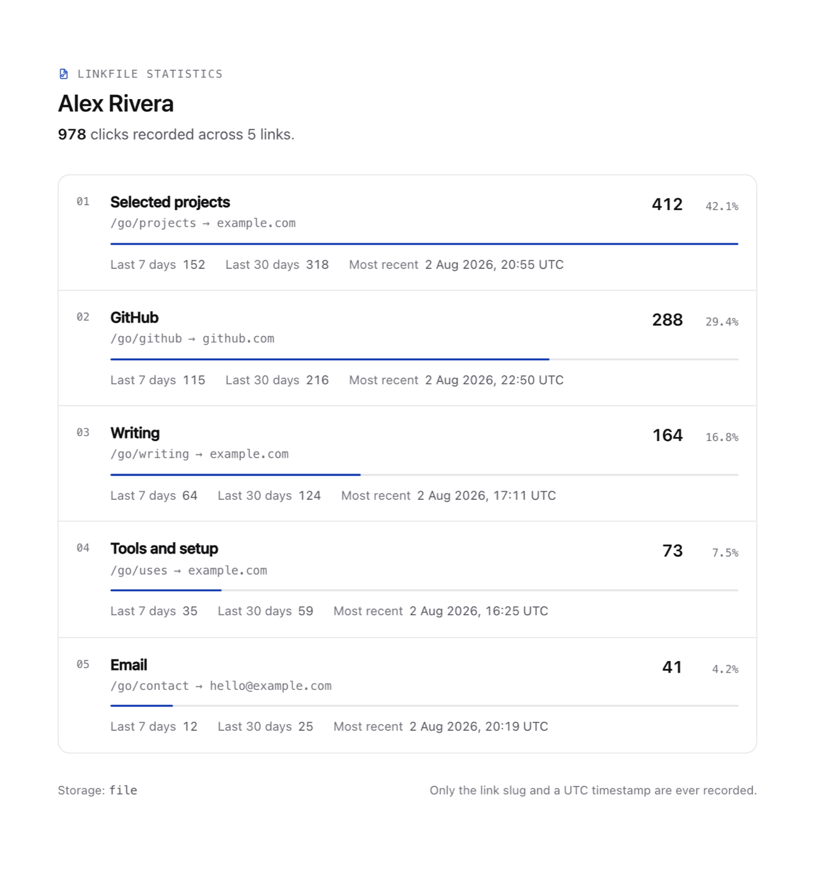

<div align="center">



# Linkfile

**Your links. One file.**

Linkfile is an open-source link-in-bio page configured from one JSON file and deployable anywhere.

[](https://github.com/erikkostashuk/linkfile/actions/workflows/ci.yml)
[](LICENSE)
[](https://vercel.com/new/clone?repository-url=https%3A%2F%2Fgithub.com%2Ferikkostashuk%2Flinkfile&env=NEXT_PUBLIC_SITE_URL,STATS_USERNAME,STATS_PASSWORD,CLICK_STORE,DATABASE_URL&envDescription=Public%20origin%2C%20%2Fstats%20credentials%20and%20click%20storage&envLink=https%3A%2F%2Fgithub.com%2Ferikkostashuk%2Flinkfile%23environment-variables&project-name=linkfile&repository-name=linkfile)

</div>

---

## Why Linkfile

Most link-in-bio tools want an account, a dashboard, a subscription and a tracking pixel on your visitors. Linkfile
wants a JSON file.

- **One file is the CMS.** Edit `links.json`, redeploy, done. No database for content, no admin UI, no login.
- **Genuinely private.** Every click records exactly two things: the link slug and a UTC timestamp. No IPs, cookies,
  user agents, referrers or fingerprints — and no third-party scripts of any kind.
- **Fast by default.** The profile page is a static, server-rendered document with no application JavaScript, no web
  fonts and no image CDN.
- **Deployable anywhere.** Vercel, Docker, a plain Node process behind Caddy or nginx. Your choice, not the vendor's.
- **Yours to change.** Plain CSS, no Tailwind, no component library, no ORM. A codebase you can read in a sitting.

## Features

| | |
|---|---|
| **Profile page** | Avatar, name, handle, bio, optional location and an ordered list of link rows |
| **Themes** | Automatic light and dark via `prefers-color-scheme`, themed by one accent colour |
| **Validation** | Zod-checked config with a JSON Schema for editor autocomplete; a bad file fails the build |
| **Click tracking** | First-party `/go/<slug>` redirects into a file log or PostgreSQL |
| **Statistics** | Password-protected `/stats` with totals, 7/30-day windows and CSS-only bars |
| **Social sharing** | Open Graph image, Twitter card, favicon and Apple touch icon generated from your config |
| **Operations** | `/api/health`, security headers, `robots.txt`, `sitemap.xml`, Person JSON-LD |
| **Accessibility** | Semantic HTML, visible focus rings, `prefers-reduced-motion`, comfortable touch targets |

## Quick start

```bash
git clone https://github.com/erikkostashuk/linkfile
cd linkfile
npm install
cp .env.example .env.local
npm run dev
```

Open <http://localhost:3000>. Then:

1. Replace `public/avatar.svg` with your own picture.
2. Edit `links.json`.
3. Deploy.

## Customize in 60 seconds

Everything on the page comes from `links.json`. Open it, change the values, save — the dev server reloads instantly.

```json
{
  "$schema": "./links.schema.json",
  "profile": {
    "name": "Alex Rivera",
    "handle": "@alexbuilds",
    "bio": "Backend engineer building reliable systems, useful developer tools, and small internet products.",
    "avatar": "/avatar.svg",
    "location": "Toronto, Canada",
    "accent": "#1d4ed8",
    "showBranding": true
  },
  "metadata": {
    "title": "Alex Rivera — Software Engineer",
    "description": "Projects, writing, open-source work, and ways to reach Alex."
  },
  "links": [
    { "slug": "projects", "title": "Selected projects", "url": "https://example.com/projects" },
    { "slug": "github", "title": "GitHub", "url": "https://github.com/example" },
    { "slug": "contact", "title": "Email", "url": "mailto:hello@example.com" }
  ]
}
```

**Three things worth knowing:**

- **Order matters.** Links render in array order.
- **Slugs are permanent-ish.** `slug` becomes `/go/<slug>` and is the key your click statistics are stored under.
  Renaming a slug starts its history over.
- **The accent is used sparingly.** Focus rings, the hover affordance, the statistics bars, the favicon and the share
  image all derive from that one hex value, and text colours are contrast-corrected automatically so any hue stays
  readable. Nothing else on the page is coloured.

### `links.json` reference

`$schema` points at `links.schema.json`, so VS Code and other editors give you autocomplete, inline docs and red
squiggles on mistakes before you ever run the app.

#### `profile`

| Field | Required | Description |
|---|---|---|
| `name` | yes | Display name, used as the page `<h1>` |
| `handle` | yes | Short handle shown in monospace under your name, e.g. `@alexbuilds` |
| `bio` | yes | One or two sentences, up to 280 characters |
| `avatar` | yes | Path inside `public/`, e.g. `/avatar.svg`. Any web image format works |
| `location` | no | Shown with a pin icon under the bio |
| `accent` | no | Hex colour (`#rgb`, `#rrggbb` or `#rrggbbaa`). Defaults to `#1d4ed8` |
| `showBranding` | no | Set `false` to hide the "Built with Linkfile" footer. Defaults to `true` |

#### `metadata`

| Field | Required | Description |
|---|---|---|
| `title` | yes | Browser tab title, Open Graph title and share-image heading |
| `description` | yes | Meta description and social preview subtitle |

#### `links[]`

| Field | Required | Description |
|---|---|---|
| `slug` | yes | Lowercase, hyphen-separated, unique. Becomes `/go/<slug>` |
| `title` | yes | The button label |
| `url` | yes | Absolute destination. Only `https:`, `http:` and `mailto:` are allowed |
| `emoji` | no | Decorative emoji shown before the title, e.g. `"emoji": "🚀"`. Omitted from the shipped example for a plainer default |

### Validation

The config is parsed and validated at build time. If it's wrong, the build fails with every problem listed at once:

```
Invalid Linkfile configuration in links.json:

  • links[1].slug: duplicate slug "github" — already used by links[0]. Every slug must be
    unique because it identifies the link in /go/<slug> and in click statistics.
  • links[2].url: protocol "javascript:" is not allowed. Use one of: https:, http:, mailto:
  • profile.accent: profile.accent must be a hex colour such as "#1d4ed8"

Fix the file and save — the schema is documented in links.schema.json.
```

Rejected outright: duplicate slugs, empty titles, unsafe protocols (`javascript:`, `data:`, `file:`, …), relative URLs,
malformed accent colours, unknown properties, and missing required profile fields.

## Environment variables

Copy `.env.example` to `.env.local`. Every value is optional — Linkfile runs with none of them set.

| Variable | Default | Description |
|---|---|---|
| `NEXT_PUBLIC_SITE_URL` | `http://localhost:3000` | Public origin, no trailing slash. Used for canonical URLs, Open Graph tags, `robots.txt` and `sitemap.xml` |
| `STATS_USERNAME` | *(unset)* | Basic Auth username for `/stats` |
| `STATS_PASSWORD` | *(unset)* | Basic Auth password for `/stats` |
| `CLICK_STORE` | `auto` | `auto`, `file` or `postgres` |
| `CLICK_LOG_PATH` | `.data/clicks.log` | Where the file store appends clicks |
| `DATABASE_URL` | *(unset)* | Standard PostgreSQL connection string |

> **`NEXT_PUBLIC_SITE_URL` is read at build time.** Next.js inlines `NEXT_PUBLIC_*` values into the compiled output, and
> the profile page is statically prerendered. Set it *before* you build, and rebuild after changing it. On Vercel this is
> automatic; the `Dockerfile` accepts it as `--build-arg`.

## Click tracking

Every link on the page points at `/go/<slug>` rather than the destination directly.

```
visitor clicks  →  GET /go/github
                   1. look the slug up in links.json (and nowhere else)
                   2. unknown slug? → 404, nothing recorded
                   3. try to record { slug, clickedAt }
                   4. 302 redirect to the configured destination
```

Two design rules hold this together:

**The destination never comes from the request.** No query parameter, header or path segment can influence where a
visitor is sent. `/go/github?url=https://evil.example.com` redirects to your configured GitHub URL and ignores the
parameter entirely. An open redirect is impossible by construction, not by filtering.

**Analytics can never break a redirect.** Recording happens inside a `try/catch`. If the disk is full, the database is
down or `CLICK_STORE` is misconfigured, the server logs a concise error and the visitor is still redirected.

### Privacy

This is the complete set of data Linkfile stores per click:

```json
{"slug":"github","clickedAt":"2026-08-02T21:00:00.000Z"}
```

Not collected, not stored, not derived: IP addresses, user agents, referrers, cookies, sessions, device fingerprints,
geolocation, or anything that identifies a person. There is no client-side analytics script, no third-party pixel, and
no outbound request from the browser to anything but your own origin — the Content Security Policy blocks it.

The privacy promise is enforced by a single type in `src/lib/clicks/types.ts`. Adding a field there is the only way to
start collecting more, which makes it reviewable in one diff.

### Storage architecture

`src/lib/clicks/` defines a small `ClickStore` interface with three implementations, chosen from the environment. Routes
and pages only ever see the interface.

| `CLICK_STORE` | Behaviour |
|---|---|
| `auto` *(default)* | PostgreSQL if `DATABASE_URL` is set; otherwise the file store — except on a serverless host, where recording is disabled |
| `file` | Always append to `CLICK_LOG_PATH`, even on serverless |
| `postgres` | Always PostgreSQL. **Fails loudly** if `DATABASE_URL` is missing rather than degrading silently |

**File store** — one JSON object per line, appended to `.data/clicks.log`. Parent directories are created
automatically, malformed or half-written lines are skipped when reading, and `.data/` is gitignored. Mount that
directory as a volume and your history survives redeploys. This is the right choice for local development, a VPS and
Docker.

**PostgreSQL store** — `pg` speaking plain parameterized SQL, no ORM. The table and index are created with
`CREATE TABLE IF NOT EXISTS` on first use, timestamps are `TIMESTAMPTZ`, and the connection pool is cached across warm
invocations. Works with any standard connection string: Neon, Supabase, RDS, or a container next to the app.

```sql
CREATE TABLE IF NOT EXISTS linkfile_clicks (
  id         BIGSERIAL PRIMARY KEY,
  slug       TEXT NOT NULL,
  clicked_at TIMESTAMPTZ NOT NULL DEFAULT now()
);
CREATE INDEX IF NOT EXISTS linkfile_clicks_slug_clicked_at_idx
  ON linkfile_clicks (slug, clicked_at DESC);
```

**Disabled** — on a serverless host with no database. See the Vercel section for why.

### Turning tracking off

Two options, depending on what you want:

- **Keep the redirect, drop the recording.** Set `CLICK_STORE=file` and point `CLICK_LOG_PATH` at `/dev/null`, or run on
  a serverless host with no `DATABASE_URL`. Links keep working; nothing is written.
- **Remove the hop entirely.** In `src/app/page.tsx`, change the link `href` from `` `/go/${link.slug}` `` to
  `link.url` and add `rel="noopener noreferrer"`. Links then go straight to their destination, `/stats` shows zeroes
  forever, and you can delete `src/app/go/` and `src/lib/clicks/`.

## Statistics



`/stats` is server-rendered and shows, per link: title, slug, destination hostname, total clicks, clicks in the last 7
and 30 days, the most recent click, and each link's share of the total — plus a CSS-only relative bar. Links with zero
clicks are always included so you see your complete configured list, and totals are sorted highest-first.

### Protecting `/stats`

Set both variables and restart:

```bash
STATS_USERNAME=owner
STATS_PASSWORD=a-long-random-passphrase
```

- **Unset credentials do not mean "public".** With either variable missing or blank, `/stats` returns **404** for
  everyone. There is no default password and no way to accidentally expose it.
- **Two independent checks.** `src/proxy.ts` rejects unauthenticated requests with a `401` and the correct
  `WWW-Authenticate` header; the page itself re-checks before rendering anything. A bypassed proxy layer alone is not
  enough to leak data.
- **Never cached.** Authenticated responses are sent with `Cache-Control: no-store, no-cache, must-revalidate, private`,
  and the page is excluded from `robots.txt` and marked `noindex`.
- **Never in the browser.** Neither variable has a `NEXT_PUBLIC_` prefix, so Next.js cannot inline them into a client
  bundle — and this project ships no client components at all.

Basic Auth sends credentials on every request, so put it behind HTTPS in production. Every deployment path below does.

## Deployment

### Vercel

[](https://vercel.com/new/clone?repository-url=https%3A%2F%2Fgithub.com%2Ferikkostashuk%2Flinkfile&env=NEXT_PUBLIC_SITE_URL,STATS_USERNAME,STATS_PASSWORD,CLICK_STORE,DATABASE_URL&envDescription=Public%20origin%2C%20%2Fstats%20credentials%20and%20click%20storage&envLink=https%3A%2F%2Fgithub.com%2Ferikkostashuk%2Flinkfile%23environment-variables&project-name=linkfile&repository-name=linkfile)

1. Fork or clone this repository.
2. Edit `links.json` and replace `public/avatar.svg`.
3. Import the repository into Vercel.
4. Set `NEXT_PUBLIC_SITE_URL` to your production URL, e.g. `https://links.example.com`.
5. Set `STATS_USERNAME` and `STATS_PASSWORD`.
6. Attach any standard PostgreSQL database (Neon, Supabase, or your own).
7. Set `DATABASE_URL` to its connection string — most providers need `?sslmode=require`.
8. Set `CLICK_STORE=postgres`.
9. Deploy.

Steps 6–8 are optional, but skipping them means **no click statistics**, and that is deliberate.

> #### Why a log file is not durable on Vercel
>
> Serverless functions run in short-lived, isolated instances with an ephemeral filesystem. Writes succeed, then vanish
> when the instance is recycled — and two concurrent instances never see each other's writes. A local click log there
> would appear to work while quietly losing most of your data.
>
> So Linkfile refuses to pretend. On a serverless host with no `DATABASE_URL` it **disables recording**: redirects keep
> working exactly as before, the server logs a one-time warning, and `/stats` tells you what to configure instead of
> displaying numbers you cannot trust. Set `DATABASE_URL` and you get durable statistics; set `CLICK_STORE=file` and you
> get the old behaviour with your eyes open.

### Docker

One command, no database:

```bash
docker compose up -d --build
```

Clicks land in `/app/.data/clicks.log`, backed by the named `linkfile-data` volume, so they survive rebuilds. The image
is multi-stage, runs as a non-root user, uses Next.js standalone output (~190 MB) and has a `HEALTHCHECK` wired to
`/api/health`.

Set your real domain before building, since it is baked into the output:

```bash
NEXT_PUBLIC_SITE_URL=https://links.example.com \
STATS_USERNAME=owner STATS_PASSWORD=a-long-random-passphrase \
docker compose up -d --build
```

Plain Docker, without Compose:

```bash
docker build --build-arg NEXT_PUBLIC_SITE_URL=https://links.example.com -t linkfile .
docker run -d --name linkfile -p 3000:3000 \
  -v linkfile-data:/app/.data \
  -e STATS_USERNAME=owner -e STATS_PASSWORD=a-long-random-passphrase \
  linkfile
```

To use PostgreSQL instead, uncomment the `db` service and the two commented environment lines in `docker-compose.yml`.

### VPS (Node.js, no Docker)

```bash
sudo useradd --system --create-home --home-dir /srv/linkfile linkfile
sudo -u linkfile git clone https://github.com/erikkostashuk/linkfile /srv/linkfile/app
cd /srv/linkfile/app
sudo -u linkfile npm ci
sudo -u linkfile NEXT_PUBLIC_SITE_URL=https://links.example.com npm run build
```

A ready-made systemd unit is in [`deploy/linkfile.service`](deploy/linkfile.service) — it runs the standalone server,
reads secrets from a `600` environment file and applies sensible sandboxing:

```bash
sudo install -o linkfile -g linkfile -m 600 /dev/null /srv/linkfile/linkfile.env
sudo -u linkfile mkdir -p /srv/linkfile/data
sudo cp deploy/linkfile.service /etc/systemd/system/
sudo systemctl daemon-reload && sudo systemctl enable --now linkfile
sudo journalctl -u linkfile -f
```

Put `CLICK_LOG_PATH=/srv/linkfile/data/clicks.log` in that env file so analytics live outside the app directory and
survive a `git pull`. **After editing `links.json` you must rebuild and restart** — the configuration is compiled into
the build.

#### Caddy

[`deploy/Caddyfile`](deploy/Caddyfile) — HTTPS is automatic, no certbot step:

```bash
sudo cp deploy/Caddyfile /etc/caddy/Caddyfile   # then edit the domain
sudo caddy validate --config /etc/caddy/Caddyfile
sudo systemctl reload caddy
```

It sets forwarded headers automatically, health-checks `/api/health`, adds HSTS, and includes a commented-out filter for
stripping client IPs from proxy logs.

#### nginx

[`deploy/nginx.conf`](deploy/nginx.conf) — HTTP→HTTPS redirect, TLS 1.2/1.3, forwarded headers, long-lived caching for
`/_next/static`, and `Authorization` passed through untouched so `/stats` keeps working:

```bash
sudo certbot --nginx -d links.example.com
sudo cp deploy/nginx.conf /etc/nginx/sites-available/linkfile   # then edit the domain
sudo ln -s /etc/nginx/sites-available/linkfile /etc/nginx/sites-enabled/
sudo nginx -t && sudo systemctl reload nginx
```

## Project structure

```
links.json               ← the only file most people ever edit
links.schema.json        ← JSON Schema powering editor autocomplete
public/avatar.svg        ← replace with your own picture

src/
  app/
    page.tsx             profile page (Server Component, no client JS)
    layout.tsx           metadata, Open Graph, accent CSS variables
    globals.css          design tokens and themes
    go/[slug]/route.ts   tracked redirect
    stats/page.tsx       password-protected statistics
    api/health/route.ts  health check for monitors and containers
    opengraph-image.tsx  generated share image
    icon.tsx             generated favicon and Apple touch icon
    robots.ts            robots.txt
    sitemap.ts           sitemap.xml
  proxy.ts               Basic Auth gate in front of /stats
  components/icons.tsx   inline SVG icons
  lib/
    config/              Zod schema, parser, loaded configuration
    clicks/              ClickStore interface + file / PostgreSQL / disabled
    auth.ts              Basic Auth parsing and constant-time comparison
    stats.ts             joins links with click totals
    color.ts             accent contrast maths
    site.ts              canonical origin

deploy/                  Caddyfile, nginx.conf, systemd unit
Dockerfile               multi-stage production image
docker-compose.yml       one-command self-hosting
```

## Development

| Command | What it does |
|---|---|
| `npm run dev` | Dev server at <http://localhost:3000> |
| `npm run build` | Production build |
| `npm start` | Serve the production build |
| `npm run lint` | ESLint |
| `npm run typecheck` | `tsc --noEmit` |
| `npm test` | Vitest, once |
| `npm run test:watch` | Vitest, watching |
| `npm run check` | Lint + typecheck + tests — run this before opening a PR |

### Testing

```bash
npm test
```

The suite covers configuration parsing, duplicate slugs and unsafe protocols, Basic Auth parsing and rejection, click
aggregation and the 7/30-day windows, file-store appends and malformed-line handling, store selection across every
environment combination, accent contrast, and the redirect route including unknown slugs and recording failures. File
tests use real temporary directories, never the repository's `.data`.

## Troubleshooting

**The build fails with "Invalid Linkfile configuration".** Read the list — every problem is reported at once with its
exact JSON path. Common causes: two links sharing a `slug`, a `url` missing its `https://` prefix, or an uppercase slug.

**Links work but `/stats` returns 404.** `STATS_USERNAME` or `STATS_PASSWORD` is unset or blank. Set both and restart.
Look for `[linkfile] /stats is disabled` in the server log.

**`/stats` shows zeroes on Vercel.** No `DATABASE_URL`, so recording is disabled by design. Attach a PostgreSQL database
and set `CLICK_STORE=postgres`.

**Canonical URLs and social previews say `localhost`.** `NEXT_PUBLIC_SITE_URL` is read at build time. Set it and rebuild
— for Docker, pass `--build-arg NEXT_PUBLIC_SITE_URL=...`.

**Clicks are not recorded on a VPS.** Check that the app's user can write to `CLICK_LOG_PATH`. Failures are logged as
`[linkfile] Failed to record click`, and the redirect still works, so this is silent from a visitor's point of view.
`curl -s localhost:3000/api/health` reports the active store.

**A PostgreSQL connection times out.** The driver is imported lazily and only when `DATABASE_URL` is set. Verify the
connection string, and add `?sslmode=require` for most hosted providers.

**Editing `links.json` on a server changes nothing.** The configuration is compiled into the build. Rebuild and restart,
or redeploy.

## No dashboard, on purpose

Linkfile has no hosted admin UI, and it never will. The JSON file *is* the CMS.

That is a real trade-off — you edit text and redeploy instead of dragging rows in a browser — and it buys a lot: your
content lives in version control with a full history, code review works on it, there is no session or account system to
secure, no content database to back up or migrate, and the whole page can be statically prerendered. If you can edit a
JSON file, you can run this. If you want a dashboard, this is the wrong tool, and that's fine.

## Contributing

Bug reports, fixes and focused improvements are welcome. See [CONTRIBUTING.md](CONTRIBUTING.md) — the short version is
run `npm run check`, keep the dependency list small, and keep the click event at two fields.

Security issues: please read [SECURITY.md](SECURITY.md) rather than opening a public issue.

## License

[MIT](LICENSE) © Erik Kostashuk
